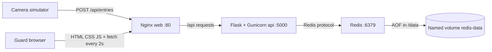

# Gatehouse architecture

## Request flow



Compose publishes only `127.0.0.1:8080 → web:80`. Service names `api` and `redis` are DNS names on the project's default Compose network. Only containers on that network can reach their unpublished ports. This local teaching app has no authentication or TLS; exposing it to an untrusted network would require further work.

## HTTP contract

| Route | Success | Errors |
| --- | --- | --- |
| `GET /api/health` | 200 `{"status":"ok"}` after Redis ping | 503 Redis unavailable |
| `POST /api/entries` with `{"plate":"ABC-123"}` | 201 `{"plate":"ABC-123","entered_at":"<UTC ISO timestamp>"}` | 400 invalid input; 409 duplicate or full; 503 Redis unavailable |
| `GET /api/parking` | 200 snapshot below | 503 Redis unavailable |
| `DELETE /api/vehicles/ABC-123` | 204 with empty body | 400 invalid plate; 404 absent; 503 Redis unavailable |

Snapshot shape:

```json
{
  "vehicles": [{"plate": "ABC-123", "entered_at": "2026-10-28T12:00:00+00:00"}],
  "recent_entries": [{"plate": "ABC-123", "entered_at": "2026-10-28T12:00:00+00:00"}],
  "count": 1,
  "capacity": 5,
  "full": false
}
```

Errors contain an `error` string. Conflicts also contain a `code`: `duplicate` or `full`. Requests are limited to 4096 bytes. JSON must be an object with a string plate; extra fields are ignored. Surrounding whitespace is removed, non-ASCII characters are rejected, and letters are uppercased before the 3–12 character pattern check.

## Redis data and concurrency

`parking:active` is a hash mapping a normalized plate to its JSON record. `parking:history` is a list of the latest 20 successful admissions, newest first. Release removes the hash entry and leaves history intact. Re-admitting a released car creates a new timestamp and history entry.

Admission uses a short Lua script in `api/storage.py`. Redis runs the script atomically: check for a duplicate; check capacity; add the hash entry; prepend history; trim history. Two Gunicorn workers or two cameras cannot both take the final free space. Duplicate messages return before capacity checks and never create extra history.

The dashboard snapshot reads hash values and history in a Redis transaction, then sorts active cars by UTC admission time. Occupancy is derived from active records rather than maintained as a second counter that could drift. This is deliberately a small classroom data set: sorting the active set in Python is sufficient for five spaces.

Redis is configured with `appendonly yes`, `appendfsync everysec`, and `dir /data`. The Docker named volume survives removal of the container. Redis 7 stores its append-only files below `/data/appendonlydir`. A clean shutdown flushes pending writes; sudden host failure can lose approximately the last second. Arrival history is bounded and is not a permanent audit trail. No backup job is provided.

## Images and Compose

- `web/Dockerfile`: Nginx 1.28 Alpine plus static assets and reverse-proxy configuration. Nginx uses Docker's resolver `127.0.0.11` and resolves the API upstream every five seconds; it can recover when an API container receives a new IP.
- `api/Dockerfile`: Python 3.12 slim, pinned direct runtime dependencies, and a non-root `appuser`. Gunicorn starts two synchronous workers on `0.0.0.0:5000`. Flask's development server is not used for deployment.
- `redis/Dockerfile`: Redis 7.4 Alpine plus a small readable persistence configuration. The official Redis entrypoint handles its runtime user and data permissions.

Base image version tags were confirmed available by a successful build. Tags can receive upstream patches; image digests observed for the deployment are recorded by Docker. Direct Python package versions were checked against PyPI and pinned: Flask 3.1.3, redis 8.1.0, Gunicorn 26.2.0. Their transitive dependencies follow the pinned packages' version constraints.

`compose.yaml` names the project `gatehouse`. Each service has `restart: unless-stopped`. Health checks are Redis ping, an API HTTP request that checks Redis, and an Nginx HTTP request. `depends_on` waits for Redis and API health during startup; it does not automatically restart dependents when a service fails later. HTTP errors and polling recovery cover runtime interruptions.

`protected-mode no` allows Redis clients on the private Compose network; Redis has no host port and no password in this local setup. Do not add a Redis host port without revisiting authentication and network access. The web host binding is loopback only.

## Dashboard behavior

The UI is plain JavaScript, so Nginx can serve it without a Node build stage. A single Promise queue serializes polling and action refreshes. A new poll is scheduled two seconds after the previous poll finishes. Requests have a seven-second browser timeout; the UI keeps the last received data and labels it as stale during an outage.

API-derived values go into `textContent` or text nodes. The car drawing is static SVG built with DOM methods. No API data is inserted with `innerHTML`. Controls are disabled during a mutation to prevent accidental repeated clicks. Server validation and Redis atomicity remain authoritative even if clients bypass the form.

The five bay markers visualize occupancy, not assigned physical bay numbers. A plate is not associated with a specific bay. For capacities above 20, the UI caps the drawing at 20 markers and shows the remaining number as text; totals still use the full capacity.

## Workflow and release

`pipeline.yml` runs validation, builds, health checks, eleven unittest cases, HTTP smoke checks, and the same container-recreation persistence test used locally. Diagnostic logs are printed on failure. The test stack stops in an `always()` step.

The publishing job depends on successful tests and runs only for `v*` tags. Its matrix builds `web`, `api`, and `redis`. `GITHUB_REPOSITORY` is lowercased for registry-compatible package names. `docker/login-action` authenticates with `GITHUB_TOKEN`, whose job scope includes `packages: write`. `docker/build-push-action` publishes the exact version tag and an OCI source label. Pull requests never publish packages.

GHCR publishing is distribution, while the local deployment is a Compose build from source. Changing a GitHub repository does not automatically update the running app on this computer. Rebuild locally with `docker compose up --build -d --wait`.

Redis connections have two-second socket/connect timeouts and explicitly disable automatic retries. The next dashboard poll is the retry. This keeps storage errors below Nginx's five-second read timeout, allowing Flask to return JSON 503 instead of a proxy-generated HTML 504.

## References

- [Flask application factories](https://flask.palletsprojects.com/en/stable/patterns/appfactories/)
- [Redis scripting and atomicity](https://redis.io/docs/latest/develop/programmability/eval-intro/)
- [Redis persistence](https://redis.io/docs/latest/operate/oss_and_stack/management/persistence/)
- [Compose startup order](https://docs.docker.com/compose/how-tos/startup-order/)
- [Compose volumes](https://docs.docker.com/reference/compose-file/volumes/)
- [GitHub publishing Docker images](https://docs.github.com/en/actions/tutorials/publish-packages/publish-docker-images)
