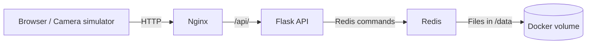

# מדריך הכנה לפרויקט Gatehouse

המטרה היא שתוכל להסביר איך רכב נכנס למערכת, איפה הנתונים נשמרים, איך Docker מפעיל את השירותים ואיך GitHub בודק ומפרסם אותם. למד לפי הסדר הבא: בכל שלב קרא מעט קוד, בצע ניסוי והסבר בקול מה קרה.

פתח PowerShell בתיקיית הפרויקט. המדריך מניח שהכתובת היא http://localhost:8080 ושלא שינית את הפורט בקובץ `.env`.

## שלב 1 הכרת האפליקציה

הפעל את המערכת ובדוק את מצב השירותים:

```powershell
docker compose up --build -d --wait
docker compose ps
Start-Process 'http://localhost:8080'
```

בצע בדפדפן:

1. הוסף רכב עם מספר שעדיין לא נמצא בחניון.
2. עקוב אחרי מספר הרכבים, המקומות הפנויים ורשימת הכניסות.
3. נסה להכניס שוב את אותו מספר ובדוק את ההודעה.
4. מלא את החניון ונסה להכניס רכב נוסף.
5. שחרר רכב באמצעות Release ובדוק שהכניסה שלו נשארת בהיסטוריה.

**בדיקת הבנה:** הסבר מה ההבדל בין רכב שחונה עכשיו לבין רישום של כניסה קודמת. ציור המקומות מציג תפוסה; הוא לא מקצה לכל רכב מקום חנייה מסוים.

## שלב 2 הבנת מסלול הבקשה



| רכיב | האחריות שלו בפרויקט |
| --- | --- |
| הדפדפן | מציג את המסך ומריץ JavaScript ששולח בקשות ומעדכן את התצוגה |
| Nginx | מגיש HTML, CSS ו־JavaScript ומעביר בקשות שמתחילות ב־`/api/` לשרת Python |
| Flask API | בודק את הקלט, מטפל בכניסה ובשחרור ומחזיר תשובות JSON |
| Redis | מחזיק את הרכבים הפעילים ואת רשימת הכניסות האחרונות |
| Docker volume | שומר את קובצי Redis גם כשהקונטיינר נמחק ונוצר מחדש |

המצלמה בפרויקט מדומה באמצעות טופס או בקשת HTTP. אין כאן זיהוי תמונות או חיבור למצלמה פיזית.

**בדיקת הבנה:** עקוב בקול אחרי לחיצה על Register arrival, מהדפדפן עד לשמירת הרכב ב־Redis וחזרה לתצוגה.

## שלב 3 קריאת הקוד לפי סדר הפעולות

קרא את הקבצים הבאים לפי הסדר. אחרי כל קובץ, הסבר את הקשר שלו לקובץ הקודם.

### צד הדפדפן

פתח את [index.html](../web/index.html) ואת [app.js](../web/app.js). חפש:

- `entry-form`: הטופס שמפעיל את הכניסה.
- `fetch`: שליחת בקשת HTTP לשרת.
- `JSON.stringify`: הפיכת אובייקט JavaScript לגוף בקשת JSON.
- `refresh` ו־`render`: קבלת הנתונים ועדכון המסך.
- `textContent`: הצגת נתוני API כטקסט.
- `poll`: בקשת העדכון הבאה מתוזמנת שתי שניות אחרי שהקודמת הסתיימה.

**בדיקת הבנה:** למה הרשימה יכולה להשתנות בלי רענון העמוד? מה מאפשר לדפדפן להציג הודעת Reconnecting ואחר כך להתאושש?

### צד השרת

פתח את [app.py](../api/app.py). התחל מ־`create_app`, ואז קרא את `normalize_plate` ואת הנתיבים:

| פעולה | נתיב | תוצאה תקינה |
| --- | --- | --- |
| כניסת רכב | `POST /api/entries` | HTTP 201 ורשומת הרכב |
| קריאת מצב החניון | `GET /api/parking` | HTTP 200 עם תפוסה, רכבים והיסטוריה |
| שחרור רכב | `DELETE /api/vehicles/<plate>` | HTTP 204 ללא גוף תשובה |
| בדיקת בריאות | `GET /api/health` | HTTP 200 אחרי תשובה תקינה מ־Redis |

עקוב אחרי הטיפול בקלט שגוי (400), רכב כפול או חניון מלא (409), רכב חסר בשחרור (404) ותקלה ב־Redis (503).

שלח בקשה בעצמך מתוך PowerShell, כשהחניון אינו מלא והמספר אינו תפוס:

```powershell
Invoke-RestMethod -Method Post -Uri 'http://localhost:8080/api/entries' `
  -ContentType 'application/json' -Body '{"plate":"STUDY-123"}'

Invoke-RestMethod 'http://localhost:8080/api/parking' | ConvertTo-Json -Depth 5

Invoke-RestMethod -Method Delete -Uri 'http://localhost:8080/api/vehicles/STUDY-123'
```

**בדיקת הבנה:** מה נשלח בבקשה, מה חוזר בתשובה ואיזה חלק בקוד מחליט אם מותר להכניס את הרכב?

### אחסון הנתונים

פתח את [storage.py](../api/storage.py). למד את ההבדל בין:

- `parking:active`: Hash שמחזיק רכבים שחונים כעת, לפי מספר הרכב.
- `parking:history`: List של 20 הכניסות המוצלחות האחרונות, מהחדשה לישנה.
- `admit`: בדיקת כפילות וקיבולת, הכנסת רכב ועדכון ההיסטוריה.
- `release`: הסרת הרכב מהחניון הפעיל.
- `snapshot`: קריאת תמונה עקבית של הנתונים לצורך הצגתם.

סקריפט Lua מאפשר ל־Redis לבצע את כל פעולת הכניסה באופן אטומי: בקשה אחרת אינה יכולה להשתחל בין בדיקת המקום הפנוי לבין הכנסת הרכב.

**בדיקת הבנה:** אם שני רכבים מגיעים כשנשאר מקום אחד, למה רק אחד מהם ייכנס? למה שחרור רכב לא מוחק את ההיסטוריה שלו?

## שלב 4 הבנת Docker

התחל מההגדרות האלה:

| מושג | משמעות |
| --- | --- |
| Image | חבילה שמכילה את סביבת הריצה, הקוד וההגדרות הדרושים לשירות |
| Container | מופע של Image בזמן ריצה, עם התהליך והמצב שלו |
| Dockerfile | הוראות לבניית Image |
| Docker Compose | הגדרה משותפת של שירותים, בנייה, רשת, פורטים ו־Volumes |
| Volume | אחסון שהחיים שלו נפרדים מחיי הקונטיינר |

קרא את [Dockerfile של ה־API](../api/Dockerfile), את [Dockerfile של Nginx](../web/Dockerfile) ואת [Dockerfile של Redis](../redis/Dockerfile). הסבר את `FROM`, `WORKDIR`, `COPY`, `RUN`, `USER`, `EXPOSE` ו־`CMD` במקום שבו הם מופיעים. שים לב: `RUN` פועל בזמן בניית התמונה; `CMD` מגדיר את פקודת הריצה של הקונטיינר.

לאחר מכן קרא את [compose.yaml](../compose.yaml) וחפש:

- שלושת השירותים: `web`, `api`, `redis`.
- `build`: איזו תיקייה משמשת לבניית כל Image.
- `ports`: הפנייה מ־`127.0.0.1:8080` במחשב אל פורט 80 בקונטיינר Nginx.
- `environment`: כתובת Redis וקיבולת החניון עבור ה־API.
- `healthcheck` ו־`depends_on`: המתנה לשירותים בריאים בזמן העלייה.
- `volumes`: חיבור `redis-data` אל `/data` בקונטיינר Redis.
- `restart`: מדיניות הפעלה מחדש של השירותים.

פתח גם את [nginx.conf](../web/nginx.conf) וראה לאן `/api/` מועבר. שמות השירותים `api` ו־`redis` נפתרים באמצעות ה־DNS הפנימי של Docker. `EXPOSE` לבדו אינו מפרסם פורט למחשב המארח.

**בדיקת הבנה:** למה הדפדפן פונה ל־localhost, ואילו Nginx פונה ל־`api:5000`? למה לא פורסם פורט Redis למחשב?

## שלב 5 ניסויים שמוכיחים הבנה

### נתונים שנשמרים אחרי יצירה מחדש

השאר רכב בחניון ורשום את מספרו ואת זמן הכניסה. הרץ:

```powershell
docker compose down
docker compose up -d --wait
```

בדוק שהרכב וזמן הכניסה נשארו. קרא את [redis.conf](../redis/redis.conf) וחבר בין `appendonly yes`, התיקייה `/data` וה־Volume שמוגדר ב־Compose.

`docker compose down -v` מוחק גם את ה־Volume ואת נתוני החניון. אל תשתמש בו בתרגיל שמטרתו להוכיח שמירת נתונים.

### שינוי קיבולת

אם עדיין אין קובץ `.env`, צור אותו מתוך `.env.example`. אם הוא קיים, ערוך אותו ושמור את ההגדרות האחרות. שנה בו את `PARKING_CAPACITY` ל־`3`, ואז הרץ:

```powershell
docker compose up -d --wait
```

בדוק שהמסך מציג קיבולת של שלושה רכבים ושנחסמת כניסה כשהחניון מלא. הורדת הקיבולת אינה מוציאה רכבים קיימים; אם צריך, שחרר רכבים דרך המסך. בסיום החזר את הערך ל־`5` והרץ שוב את הפקודה.

### קריאת הבדיקות והרצתן

```powershell
docker compose exec -T api python -m unittest discover -s tests -v
python scripts/check_demo.py
```

פקודת הבדיקה השנייה דורשת Python במחשב ולפחות מקום פנוי אחד. היא מכניסה ומשחררת רכב בדיקה משלה. בדיקות האחסון משתמשות במפתחות Redis נפרדים מנתוני ההדגמה.

קרא את [test_api.py](../api/tests/test_api.py) ואת [test_storage.py](../api/tests/test_storage.py). בחר שלוש בדיקות והסבר איזו תקלה כל אחת הייתה מגלה. מצא במיוחד את בדיקת שתי הכניסות המתחרות על המקום האחרון ואת בדיקת מדיניות הניסיונות החוזרים של Redis.

## שלב 6 הבנת ה־Pipeline

קרא את [pipeline.yml](../.github/workflows/pipeline.yml) מלמעלה למטה:

1. `on` קובע אילו אירועים מפעילים את ה־Workflow.
2. Job הבדיקות מאמת Compose, בונה Images ומפעיל את המערכת.
3. הוא מריץ בדיקות API ו־Redis ובדיקות HTTP.
4. הוא יוצר ומאמת רשומה משני צדדים של `down` ו־`up`, כדי להוכיח התמדה.
5. אם נשלח Tag שמתחיל ב־`v`, ורק אחרי הצלחת הבדיקות, Job הפרסום בונה ומפרסם שלוש תמונות ל־GHCR.
6. `GITHUB_TOKEN` משמש להזדהות; `packages: write` מאפשר פרסום חבילות. שלב נוסף מאמת שה־Manifest שפורסם ניתן לקריאה.

פתח את לשונית Actions ב־[מאגר GitHub](https://github.com/liamlz11/DevOps-Project/actions) ועקוב אחרי ריצה מוצלחת. פרסום Images ב־GHCR אינו מעדכן אוטומטית את האפליקציה שרצה במחשב שלך; להפעלת שינוי מקומי בונים ומפעילים שוב עם Compose.

**בדיקת הבנה:** מה ההבדל בין push רגיל ל־`main` לבין שליחת Tag של גרסה? מה ההבדל בין בניית Image, פרסום Image והפעלת קונטיינר?

## הכנה להצגה בכיתה

כשתוכל להסביר את המסלול מקליק ועד Redis, עבור ל־[מדריך ההדגמה ושאלות החזרה](DEMO.md). השתמש ב־[מסמך הארכיטקטורה](../ARCHITECTURE.md) כדי להשלים פרטים וב־[תיעוד השימוש ב־AI](../AI_USAGE.md) כדי להבין את הטעויות שתוקנו.

בדוק שאתה מסוגל לבצע ולהסביר את הפעולות הבאות בעצמך:

- [ ] להפעיל את המערכת ולזהות את שלושת השירותים.
- [ ] לתאר בקשת כניסה ואת תשובת השרת.
- [ ] להצביע בקוד על בדיקת קלט, חסימת כפילות וחסימת חניון מלא.
- [ ] להסביר למה הנתונים נשמרים אחרי יצירה מחדש של הקונטיינרים.
- [ ] להסביר למה סקריפט הכניסה ב־Redis אטומי.
- [ ] להסביר למה הדף מתעדכן בלי רענון.
- [ ] להריץ בדיקות ולהסביר מה הן מוכיחות.
- [ ] להראות ריצת CI ואת שלוש התמונות שפורסמו ב־GHCR.
- [ ] להסביר טעות אמיתית של ה־AI ואת התיקון שלה.
- [ ] לבצע הדגמה של 5–10 דקות ולענות על שאלות מתוך הבנת הקוד.
